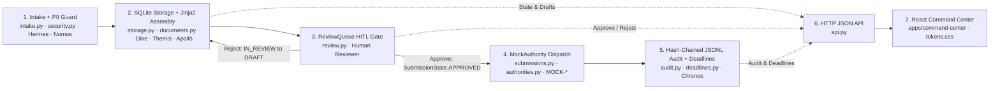
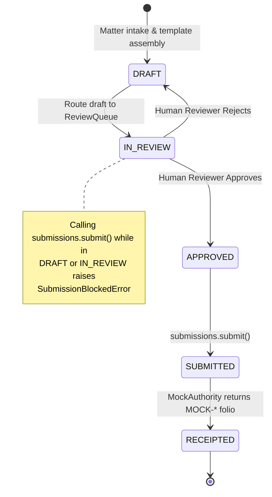

# `ARCHITECTURE.md` — System Architecture & Pipeline Specification

`legaltech-innovation-lab` implements a local-first, synthetic-only LegalTech workflow engine paired with an Editorial LegalTech Command Center. Every stage enforces deterministic rendering, automated PII/secret screening, hash-chained auditability, and a non-bypassable Human-in-the-Loop (HITL) approval gate.

---

## 1. End-to-End System Pipeline

The architecture separates matter intake, compliance screening, state persistence, deterministic document assembly, human approval, mock dispatch, and UI presentation into discrete pipeline stages:

### Pipeline Stage Walkthrough

1. **Intake + PII Guard (`intake.py`, `security.py`):**
   - `Hermes` normalizes synthetic intake payloads into typed domain models (`models.py`).
   - `Nomos` runs PII and secret guardrails (`RFC`, `CURP`, `CLABE`, private keys, real-case quarantine patterns) and evaluates EU AI Act / LFPDPPP governance readiness (`evaluate_governance_readiness`).
2. **SQLite Storage + Jinja2 Assembly (`storage.py`, `documents.py`):**
   - `storage.py` persists matters, documentary annexes (`Dike`), extracted facts vs. legal conclusions (`Themis`), deadlines (`Chronos`), and draft versions in local SQLite.
   - `Apollō` renders Jinja2 legal templates from `templates/` using `jinja2.StrictUndefined` so missing context fields fail fast.
3. **ReviewQueue HITL Gate (`review.py`):**
   - Rendered drafts enter `ReviewQueue` in `SubmissionState.IN_REVIEW`.
   - A human reviewer inspects fact citations, OCR flags, compliance status, and procedural deadlines, then either **approves** (`IN_REVIEW -> APPROVED`) or **rejects** (`IN_REVIEW -> DRAFT`) with review notes.
4. **MockAuthority Dispatch (`submissions.py`, `authorities.py`):**
   - `submissions.submit()` strictly asserts `SubmissionState.APPROVED`. Any attempt to submit from `DRAFT`, `IN_REVIEW`, or other non-approved states raises `SubmissionBlockedError`.
   - Approved payloads route strictly to `MockAuthority`, returning a synthetic receipt with a `MOCK-` folio prefix.
5. **Hash-Chained JSONL Audit + Deadlines (`audit.py`, `deadlines.py`):**
   - Every transition, blocked attempt, review decision, and `MOCK-` receipt appends a SHA-256 hash-chained record to the JSONL audit log, verifiable via `AuditLog.verify_integrity()`.
   - `Chronos` (`deadlines.py`) updates and surfaces response and filing windows tied to the matter lifecycle.
6. **HTTP JSON API (`api.py`):**
   - Exposes local JSON endpoints for matters, drafts, `ReviewQueue` approval/rejection actions, `Chronos` deadlines, `Nomos` security readiness, and `AuditLog` verification.
7. **React Command Center (`apps/command-center/`):**
   - React 18 + Vite 3-column Editorial LegalTech workstation styled via `tokens.css` (`docs/DESIGN_SYSTEM.md`), giving reviewers live visibility and explicit HITL approval controls.

---

## 2. Submission State Machine

Every legal submission follows a strict finite state machine. Direct transitions from `DRAFT` or `IN_REVIEW` to `SUBMITTED` are forbidden and guarded by `SubmissionBlockedError` in `submissions.py`.

### State Definitions

| State (`SubmissionState`) | Description | Allowed Next States | Actor Permitted |
| :--- | :--- | :--- | :--- |
| `DRAFT` | Initial normalized matter or rejected draft under revision. | `IN_REVIEW` | Domain Agents (`Hermes` / `Apollō`) |
| `IN_REVIEW` | Queued in `ReviewQueue` awaiting human inspection; blocked from dispatch. | `APPROVED`, `DRAFT` | **Human Reviewer Only** |
| `APPROVED` | Explicitly signed off by human reviewer; eligible for `submissions.submit()`. | `SUBMITTED` | `submissions.py` |
| `SUBMITTED` | Passed HITL gate and handed off to `MockAuthority`. | `RECEIPTED` | `authorities.py` (`MockAuthority`) |
| `RECEIPTED` | Simulated dispatch completed with `MOCK-` folio and sealed audit hash. | Terminal | `audit.py` |

---

## 3. Monorepo Module Inventory

### Backend Core Engine (`packages/legal_engine/`)

| Module Path | Component / Symbols | Architectural Responsibility |
| :--- | :--- | :--- |
| `packages/legal_engine/models.py` | `SubmissionState`, domain dataclasses | Core typed entities for matters, facts, legal analyses, annexes, deadlines, reviews, and receipts. |
| `packages/legal_engine/intake.py` | Intake parsers & validators | Normalizes synthetic matter payloads from `examples/` or API inputs into domain records. |
| `packages/legal_engine/documents.py` | Jinja2 `StrictUndefined` assembler | Loads templates from `templates/` and renders deterministic legal drafts with zero silent variable fallbacks. |
| `packages/legal_engine/review.py` | `ReviewQueue` | Manages `IN_REVIEW` queue items, captures reviewer decisions, and executes `APPROVED` / `DRAFT` transitions. |
| `packages/legal_engine/submissions.py` | `submit()`, `SubmissionBlockedError` | Enforces mandatory HITL gate (`SubmissionState.APPROVED`) before invoking authority transport. |
| `packages/legal_engine/authorities.py` | `MockAuthority` | Isolated mock authority adapter issuing deterministic `MOCK-` folio receipts; zero live judicial endpoints. |
| `packages/legal_engine/deadlines.py` | Deadline calculator (`Chronos`) | Computes procedural filing and response windows and flags urgent thresholds. |
| `packages/legal_engine/audit.py` | `AuditLog`, `AuditLog.verify_integrity()` | Append-only SHA-256 hash-chained JSONL ledger recording all lifecycle and HITL events. |
| `packages/legal_engine/storage.py` | SQLite persistence layer | Schema initialization and CRUD operations for matters, drafts, annexes, deadlines, and review history. |
| `packages/legal_engine/security.py` | Guardrail scanner, `evaluate_governance_readiness` | Detects `RFC`, `CURP`, `CLABE`, PEM/FIEL keys, real-case markers, and evaluates LFPDPPP / EU AI Act readiness. |
| `packages/legal_engine/api.py` | Local HTTP JSON API server | Exposes REST/JSON endpoints consumed by the React Command Center (`127.0.0.1:8790` default). |
| `packages/legal_engine/cli.py` | CLI commands (`demo`, `security-check`, etc.) | Operator entrypoint for synthetic demos, security scans, audit verification, and local server startup. |

### Supporting Python Workspace Directories

| Path | Purpose |
| :--- | :--- |
| `templates/` | Jinja2 templates rendered exclusively under `StrictUndefined` in `documents.py`. |
| `examples/` | 100% synthetic sample dossiers, annex metadata, and demo payloads. |
| `tests/` | Automated `pytest` suite covering intake, assembly, HITL gate blocks, PII guardrails, hash-chain verification, and API routes. |

### Command Center Frontend (`apps/command-center/`)

| Path / Artifact | Component / Layer | Architectural Responsibility |
| :--- | :--- | :--- |
| `apps/command-center/` | React 18 + Vite application | Local web workstation connecting to `packages/legal_engine/api.py`. |
| `apps/command-center/src/.../tokens.css` | Design System CSS tokens | Implements `--bg-obsidian`, `--bg-parchment`, `--bg-parchment-elevated`, semantic accents, and typography scale (`docs/DESIGN_SYSTEM.md`). |
| `apps/command-center/` (Left Column) | Agent Rail | Displays the 6-agent Domain Legal Constellation (`Hermes`, `Themis`, `Dike`, `Nomos`, `Chronos`, `Apollō`) and governance status. |
| `apps/command-center/` (Center Column) | Orchestration & HITL Review Gate | Renders draft preview, Fact-vs-Conclusion separation panels, and interactive Approve / Reject controls. |
| `apps/command-center/` (Right Column) | Evidence & Audit Inspector | Displays documentary annexes, OCR flags, procedural deadlines, PII scan status, and hash-chained `AuditLog` entries. |
