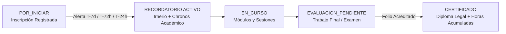

# Agente Irnerio de Bolonia: Academia Jurídica Continua, Diplomados y Certificaciones Legales
**LegalTech Innovation Lab · Specialized Lawyer Practice Academy Module**

## 1. Propósito: Enfoque 100% Especializado en la Práctica Legal
A diferencia de asistentes generalistas (como **Muse**) que mezclan suscripciones comerciales, entretenimiento y pendientes personales sin jerarquía procesal, el módulo **Academia & Certificación Legal** opera dentro de un entorno aislado exclusivamente para la **práctica jurídica del abogado**.

* **Cero Ruido Generalista:** Únicamente indexa cursos, seminarios, diplomados y certificaciones vinculados al Derecho (Casas de la Cultura Jurídica de la SCJN, Escuela Federal de Formación Judicial, Institutos Judiciales estatales, Barras y Colegios de Abogados).
* **Vinculación con el Consejo de Jurisconsultos:** Cada programa académico queda enlazado con el agente histórico que potencia esa materia en el despacho:
  - *Mercantil, Pagarés y Usura* $\rightarrow$ **Ulpiano & Cicerón**
  - *Juicio de Amparo y Derechos Humanos* $\rightarrow$ **Montesquieu**
  - *Pruebas Digitales y Licitud Probatoria* $\rightarrow$ **Temis**
  - *Medidas Cautelares y Embargo Precautorio* $\rightarrow$ **Julio César**

---

## 2. Ciclo de Vida de Formación Continua

---

## 3. Reglas Operativas y Trazabilidad
1. **Alertamiento Anticipado Real:** `compute_course_reminders()` calcula los días restantes hacia `next_milestone_date` desde la fecha del sistema y prioriza:
   - **`high` (Urgente):** `days_until <= 3` (curso por iniciar de forma inminente o evaluación inmediata).
   - **`medium` (Próximo):** `4 <= days_until <= 7`.
   - **`low` (Programado):** `days_until > 7`.
2. **Expediente Curricular Anual:** `summarize_lawyer_academy()` contabiliza diplomados/certificados logrados en el año y horas de actualización jurídica acreditadas frente a horas inscritas.
3. **Auditoría SHA-256 & Cero PII Real:** Cada alta o obtención de certificado sintético pasa por `assert_synthetic_and_safe()` en backend y deja traza append-only en la bitácora SHA-256 del Command Center.
