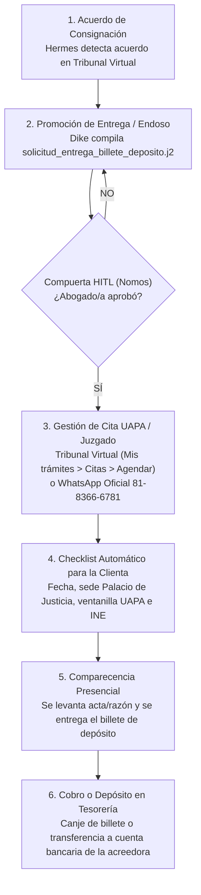

# Manual Operativo y Biblioteca Informática Oficial: Tribunal Virtual PJENL, Citas UAPA y Billetes de Depósito
**LegalTech Innovation Lab · Módulo de Pensión Alimenticia, Gestión de Valores & E-Justicia Nuevo León**

---

## 1. Canales Oficiales Verificados del Poder Judicial del Estado de Nuevo León (PJENL)

De acuerdo con la verificación directa sobre **`pjenl.gob.mx`**, **`tribunalvirtual.pjenl.gob.mx`** y la compilación legislativa del H. Congreso de Nuevo León:

| Canal | Acceso / Referencia Oficial | Horario / Ruta Exacta | Qué Se Puede Gestionar |
| :--- | :--- | :--- | :--- |
| **Tribunal Virtual PJENL** | [tribunalvirtual.pjenl.gob.mx](https://tribunalvirtual.pjenl.gob.mx/) | 24/7 (Cita UAPA: **`Mis trámites > Citas > Agendar`**) | Consulta de *Mis Expedientes*, envío en Oficialía Virtual, notificaciones electrónicas, exhortos, copias certificadas electrónicas y citas ante UAPA / Juzgados. |
| **Convenio Electrónico y Privacidad** | [TVConvenio.pdf](https://tribunalvirtual.pjenl.gob.mx/htm/TVConvenio.pdf) · [TVPrivacidad.pdf](https://tribunalvirtual.pjenl.gob.mx/htm/TVPrivacidad.pdf) | Lectura pública directa | Reglas vinculantes de uso, captura de datos, custodia de contraseñas, responsabilidades e integración normativa (**Art. 54 CPCNL**). |
| **Videotutoriales y Campus Virtual (`SiC@Vi`)** | [Instituto/Tutoriales](https://www.pjenl.gob.mx/Instituto/Tutoriales/) · [SiC@Vi](https://www.pjenl.gob.mx/Instituto/SiCavi/) | Disponible 24/7 en línea | Videos oficiales `.mp4` (p. ej. registro y uso de campus `SiC@Vi`, evaluaciones virtuales) y portal académico (la ruta antigua `/Instituto/micrositio-tutoriales.html` ya no está vigente; la ruta activa es **`/Instituto/Tutoriales/`**). |
| **Mesa de Ayuda Informática (CST)** | `cst@pjenl.gob.mx` · Tel. **`(81) 2020-7751`** | Días y horas hábiles judiciales | Soporte técnico de la **Dirección de Informática del PJENL**, incidencias de acceso y reportes técnicos del sistema. |
| **Asistente Virtual WhatsApp PJENL** | **`81-8366-6781`** | Lunes a viernes, **`08:30` a `16:00` hrs** | Orientación de trámites, juzgados y gestión de citas administrativas (incluyendo entrega de valores/billetes). |
| **Atención Presencial / UAPA** | Ventanilla **UAPA** / Juzgado Oral Familiar | Días y horas hábiles judiciales | Comparecencias de entrega/endoso de billetes de depósito, ratificaciones y devolución de documentos. |

---

## 2. Por Qué Muchos Abogados No Encuentran "El Manual" en Buscadores (y Dónde Está Realmente)

1. **Modalidad Interna (Personal Judicial) vs. Modalidad Externa (Litigantes):**  
   El manual operativo completo de pantallas internas que conocen quienes laboraron dentro del PJENL corresponde a los lineamientos internos regulados por el **Acuerdo General Conjunto `4-II/2014`** (*Lineamientos internos para el acceso y uso de la aplicación web Tribunal Virtual, en su modalidad de administración judicial*, `09/07/2014`). Para el público externo y litigantes, los manuales viven dispersos en tres fuentes oficiales: el **Segundo Título Especial del CPCNL** (Arts. 44–87), el **[TVConvenio.pdf](https://tribunalvirtual.pjenl.gob.mx/htm/TVConvenio.pdf)**, los **Acuerdos Generales del TSJ/CJ** (`/PoderJudicial/TSJ/Pleno/acuerdos-generales.aspx`) y las cápsulas en **`Instituto/Tutoriales/`** y **`@PJENL`** en YouTube.
2. **Aclaración sobre "Dialoga" vs. Mediación en Línea (`IMASC`):**  
   En la normativa oficial vigente publicada en `pjenl.gob.mx` no aparece un módulo llamado públicamente *"Dialoga"* dentro del portal del Tribunal Virtual; los mecanismos alternativos y mediación digital se regulan formalmente a través del **Instituto de Mecanismos Alternativos para la Solución de Controversias (`IMASC`)** bajo el *Reglamento de la Ley de MASC para el Estado de Nuevo León* (Acuerdos Generales **`8/2017`**, **`16/2017`**, **`2/2019`**, **`10/2022`** y **`13/2022`**) y su enlace al sistema de notificaciones UMC (**Acuerdo `14/2017`**).

---

## 3. Desglose Normativo: *Segundo Título Especial "Del Tribunal Virtual"* (Arts. 44 al 87 del Libro Séptimo CPCNL)

Complementado por los **Artículos 21, 33, 52 y 78 del Libro Primero** del Código de Procedimientos Civiles de Nuevo León:

| Artículos | Sección / Regla Legal | Impacto Práctico para el Abogado Litigante |
| :--- | :--- | :--- |
| **Arts. 21, 33, 52** | Firma, horario 24/7 y términos de acuerdo | Las actuaciones en Tribunal Virtual se autentican electrónicamente (**Art. 21**); promociones enviadas en días/horas inhábiles se tienen por recibidas al momento hábil siguiente, **salvo promociones sujetas a término judicial**, donde corre hasta las 24:00 hrs del día de vencimiento (**Arts. 33 y 63**); autos/decretos deben dictarse en 48 hrs (**Art. 52**). |
| **Arts. 44–51** | Definiciones y 4 funciones matrices | Consolida 4 funciones legales (**Art. 50**): (1) formación del expediente electrónico, (2) consulta controlada, (3) recepción electrónica de promociones y (4) notificación electrónica. Faculta al TSJ y al Consejo de la Judicatura (y su Dirección de Informática) para emitir acuerdos técnicos (**Art. 51**). |
| **Arts. 52–60** | Bitácora diaria y mantenimiento programado | El Administrador conserva una **bitácora histórica diaria** (**Art. 53**). Cualquier mantenimiento programado que suspenda el servicio exige aviso mínimo con **5 días hábiles de anticipación** (**Art. 56**); ante fallas imprevistas se publican acuerdos alternos en el Boletín Judicial (**Art. 59**). |
| **Arts. 61–69** | Consulta de expedientes e incongruencias | Requiere autorización **individual por expediente** con constancia secretarial de día y hora (**Art. 61**). Si existe discrepancia entre el expediente físico y el electrónico, prevalece el físico, pero si es error de captura debe corregirlo el Administrador (**Art. 62**). Si el juzgado ya dictó el auto autorizando acceso pero olvidó activarlo en sistema, el **Art. 64** permite solicitar la activación **directamente al Administrador**. |
| **Arts. 70–75** | Promociones electrónicas y **salvamento de término** | La facultad para *presentar promociones* requiere petición expresa conforme al **Art. 78** y contraseña adicional (**Arts. 70–71**). La hora legal de presentación es la del acuse en base de datos (**Art. 73**). El Secretario debe imprimir y certificar promociones al inicio y final de la jornada laboral bajo sanción (**Art. 74**). **Clave Art. 75:** si una falla propia del Tribunal Virtual impide enviar en término, se invoca en la promoción y el juez pedirá reporte técnico al Administrador antes de acordar. |
| **Arts. 76–78 bis** | Notificaciones electrónicas y nulidad | Al solicitar consulta electrónica se aceptan notificaciones personales por Tribunal Virtual (**Art. 77**), **excepto el emplazamiento y mandamientos de ejecución**. La nulidad de una notificación electrónica se tramita vía incidental (**Art. 78 bis**). |
| **Arts. 79–80** | Exhortos y despachos electrónicos | Los medios de comunicación procesal generados en Tribunal Virtual crean un expediente electrónico independiente con constancia de envío/recepción para cómputo exacto de términos. |
| **Arts. 81–87** | Servicios accesorios | *Lista automática de expedientes autorizados* (con baja voluntaria), *Consulta por expediente*, *Búsqueda por partes* alimentada por Boletín Judicial, y *Enviar comentario* directo al Administrador. |

---

## 4. "Todo Esto Puedes Hacer Con el Tribunal Virtual, ¿Sabías?" — 10 Herramientas Avanzadas (Acuerdos 2011–2025)

1. **`Acuerdo General Conjunto 2-II/2025` (`02/07/2025`) — Sobre Electrónico de Posiciones:** Permite exhibir y resguardar en formato electrónico cerrado el pliego de posiciones para la prueba confesional sin depender exclusivamente del sobre físico tradicional. ([PDF Oficial](https://www.pjenl.gob.mx/PoderJudicial/TSJ/Pleno/Acuerdos/2025/Acuerdo02-II.pdf))
2. **`Acuerdo General Conjunto 1-II/2025` (`02/07/2025`) — Firma Electrónica Avanzada (`FEJUD`) + e.firma SAT (`Acuerdo 7/2017`):** Autenticación criptográfica propia del Poder Judicial (`FEJUD`) junto con las reglas vigentes para el uso de la FIEL del SAT en promociones y resoluciones judiciales. ([PDF FEJUD](https://www.pjenl.gob.mx/PoderJudicial/TSJ/Pleno/Acuerdos/2025/Acuerdo01-II.pdf))
3. **`Acuerdos Generales 7/2022 y 8/2022` (`13/05/2022`) — Oficios Electrónicos Directos a Empleadores, Bancos y Auxiliares NO Partes:** Permite registrar a patrones/empresas empleadoras, peritos y entidades públicas o privadas *que no son parte en el juicio* para enviarles y recibirles comunicaciones y oficios por vía electrónica (fundamental para acelerar descuentos de pensión alimenticia sin diligenciar papel). ([PDF 7/2022](https://www.pjenl.gob.mx/PoderJudicial/CJ/Pleno/Acuerdos/2022/Acuerdo07.pdf))
4. **`Artículo 75 CPCNL` — Escudo Legal de Salvamento de Términos por Caída de Plataforma:** Permite acreditar interrupciones del sistema contrastándolas contra la bitácora oficial del Administrador (`Art. 53 CPCNL`) cuando el vencimiento judicial ocurre durante una falla técnica imputable al portal.
5. **`Artículo 64 CPCNL` — Activación Directa Ante el Administrador Cuando el Juzgado Olvida el Alta Electrónica:** Si en autos ya se dictó el acuerdo que autoriza Tribunal Virtual pero en la pantalla del sistema sigue bloqueado el expediente, puedes pedir directamente al Administrador la habilitación electrónica verificando el auto.
6. **`Artículos 79–80 CPCNL` y `Acuerdos 5-II/2013` + `2-II/2017` — Exhortos y Despachos por Vía Electrónica:** Envío, recepción, diligenciación y devolución electrónica con expediente independiente sin traslados físicos entre distritos. ([PDF 2-II/2017](https://www.pjenl.gob.mx/PoderJudicial/TSJ/Pleno/Acuerdos/2017/Acuerdo02-II.pdf))
7. **`Acuerdos 3-II/2014` y `7-II/2021` (`05/11/2021`) — Remisión Electrónica de Incompetencias Mercantiles y Constancias Entre Órganos:** Transferencia electrónica directa de información procesal y competencias mercantiles entre juzgados y salas. ([PDF 7-II/2021](https://www.pjenl.gob.mx/PoderJudicial/TSJ/Pleno/Acuerdos/2021/Acuerdo07-II.pdf))
8. **`Acuerdo General Conjunto 3-II/2015` (`29/05/2015`) — Copias Certificadas en Formato Electrónico:** Expedición y validación digital de constancias certificadas de autos y resoluciones sin esperar fotocopiado ni cotejo físico tradicional. ([PDF 3-II/2015](https://www.pjenl.gob.mx/PoderJudicial/TSJ/Pleno/Acuerdos/2015/Acuerdo03-II.pdf))
9. **`Acuerdos 15/2011`, `5/2018` y `16/2022` — Cobertura Penal Acusatoria, Ejecución, Adolescentes y Juzgado Laboral:** Consulta y sustanciación digital de carpeta judicial penal y juicios laborales estatales integrados al Tribunal Virtual (más allá de materia civil/familiar/mercantil).
10. **`Acuerdo General Conjunto 1-II/2024` (`18/06/2024`), `Reglamento UMC`, Citas UAPA y Cabinas Virtuales:** Marco integral de medios electrónicos judiciales, agenda en línea de actuarios de la Unidad de Medios de Comunicación (UMC), audiencias por videollamada en Cabinas Virtuales gratuitas y citas administrativas por **`Mis trámites > Citas > Agendar`** o WhatsApp **`81-8366-6781`**. ([PDF 1-II/2024](https://www.pjenl.gob.mx/PoderJudicial/TSJ/Pleno/Acuerdos/2024/Acuerdo01-II.pdf))

---

## 5. Flujo Administrativo y Procesal: Billete / Certificado de Depósito en Alimentos

En los juicios orales de pensión alimenticia (o convenios familiares con consignación periódica), cuando el deudor alimentario consigna un **billete o certificado de depósito**, cobrarlo exige superar un trámite administrativo de varias etapas:

### Cómo Automatiza Este Módulo ([alimony.py](file:///Users/user/.gemini/antigravity/scratch/legaltech-innovation-lab/packages/legal_engine/alimony.py)) Sin Romper el Control Humano
1. **Compilación Determinista ([solicitud_entrega_billete_deposito.j2](file:///Users/user/.gemini/antigravity/scratch/legaltech-innovation-lab/templates/solicitud_entrega_billete_deposito.j2)):** Usa `jinja2.StrictUndefined` para estructurar la solicitud dirigida al juzgado familiar.
2. **Motor de Citas (`schedule_uapa_deposit_appointment`):** Selecciona canal (`TRIBUNAL_VIRTUAL`, `WHATSAPP_PJENL`, `TELEFONO_PJENL` o `PRESENCIAL_UAPA`), bloquea cualquier emisión sin aprobación nominal del abogado (`lawyer_approver`) y genera el checklist de 4 pasos para comparecencia presencial y cobro en Tesorería.
3. **Biblioteca Informática Embevible (`PJENL_INFORMATICS_LIBRARY`):** Expone en Python las 10 capacidades avanzadas y citas normativas verificadas para consulta directa del abogado y los agentes del Consejo.
