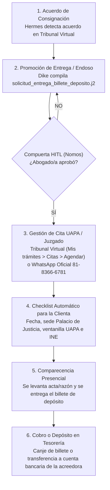

# Manual Operativo: Tribunal Virtual PJENL, Citas UAPA y Entrega de Billetes de Depósito
**LegalTech Innovation Lab · Módulo de Pensión Alimenticia & Gestión de Valores**

---

## 1. Canales Oficiales Verificados del Poder Judicial del Estado de Nuevo León (PJENL)

De acuerdo con la documentación y portales oficiales publicados en **`pjenl.gob.mx`**:

| Canal | Acceso / Referencia Oficial | Horario / Ruta Exacta | Qué Se Puede Gestionar |
| :--- | :--- | :--- | :--- |
| **Tribunal Virtual PJENL** | [tribunalvirtual.pjenl.gob.mx](https://tribunalvirtual.pjenl.gob.mx/) | 24/7 (Ruta de citas: **`Mis trámites > Citas > Agendar`**) | Consulta de *Mis Expedientes*, envío en Oficialía de Partes Virtual, recepción de promociones electrónicas y agendado de citas ante UAPA / Juzgados. |
| **Asistente Virtual WhatsApp PJENL** | **`81-8366-6781`** | Lunes a viernes, **`08:30` a `16:00` hrs** | Información de juzgados, orientación de trámites y registro de citas administrativas para entrega de valores. |
| **Atención Telefónica / Presencial** | Ventanilla **UAPA** / Juzgado Oral Familiar | Días y horas hábiles judiciales | Atención directa de comparecencias, devolución de documentos y entrega de billetes o certificados de depósito. |

---

## 2. Flujo Administrativo y Procesal: Billete / Certificado de Depósito en Alimentos

En los juicios orales de pensión alimenticia (o convenios familiares con consignación periódica), cuando el deudor alimentario consigna un **billete o certificado de depósito**, cobrarlo exige superar un trámite administrativo de varias etapas:

---

## 3. Cómo Automatiza Este Módulo Sin Romper el Control Humano

1. **Detección e Integración Documental (`documents.py` + `templates/`):** La plantilla determinista [solicitud_entrega_billete_deposito.j2](file:///Users/user/.gemini/antigravity/scratch/legaltech-innovation-lab/templates/solicitud_entrega_billete_deposito.j2) usa `jinja2.StrictUndefined` para preparar el escrito dirigido al juzgado familiar solicitando la entrega/endoso del billete consignado.
2. **Motor de Citas y Comparecencia ([alimony.py](file:///Users/user/.gemini/antigravity/scratch/legaltech-innovation-lab/packages/legal_engine/alimony.py)):**
   - Prepara la solicitud de cita seleccionando canal (`TRIBUNAL_VIRTUAL`, `WHATSAPP_PJENL`, `TELEFONO_PJENL` o `PRESENCIAL_UAPA`).
   - Exige **aprobación nominal del abogado responsable (`lawyer_approver`)** antes de confirmar o emitir cualquier folio (`MOCK-CITA-UAPA-...` en laboratorio; nunca realiza envíos reales sin autorización ni almacena credenciales e.firma/FIEL).
   - Genera automáticamente un **checklist claro para la clienta**:
     1. Llevar identificación oficial vigente (INE / Pasaporte) y el folio de cita confirmada.
     2. Acudir puntualmente al **Palacio de Justicia / ventanilla UAPA** asignada.
     3. Firmar la **comparecencia de entrega del billete / certificado de depósito**.
     4. Pasar con el billete endosado/recibido a **Tesorería / Finanzas** para su cobro en ventanilla o depósito directo en su cuenta bancaria.
3. **Referencia Normativa Oficial:** Consultar siempre los avisos vigentes, el *Convenio Electrónico del Tribunal Virtual* y manuales operativos publicados en **`https://www.pjenl.gob.mx`** y **`https://tribunalvirtual.pjenl.gob.mx/`** antes de ejecutar promociones en producción.

---

## 4. Marco Normativo Informático y Herramientas del PJENL que Muchos Abogados Desaprovechan

### A. Sustento Legal e Informático del Sistema
* **Segundo Título Especial del Código de Procedimientos Civiles de Nuevo León ("Del Tribunal Virtual"):** Rige la consulta controlada, envío electrónico de promociones y obligatoriedad del sistema.
* **Ley Orgánica del PJENL y Reglamento Orgánico Interior del Consejo de la Judicatura:** Facultan al Consejo de la Judicatura y su **Dirección de Informática / Tecnologías de la Información** para emitir políticas de ciberseguridad, integridad de bases de datos, firma electrónica y operación técnica.
* **Acuerdos Generales Conjuntos (p. ej. `8/2020-II`, `3/2021-II` y actualizaciones) + Convenio Electrónico de Uso:** Establecen las reglas vinculantes de operación digital y validez de notificaciones, oficios y audiencias remotas.

### B. Herramientas Subutilizadas Dentro del Ecosistema PJENL
1. **Unidad de Medios de Comunicación (UMC) — Agenda y Línea de Tiempo de Notificaciones:** Permite agendar, confirmar y rastrear en línea emplazamientos y diligencias de actuario paso a paso sin hacer fila física en el área de actuaría.
2. **Oficios Electrónicos:** Recepción y consulta digital de oficios girados a dependencias, instituciones o peritos, eliminando traslados solo para recoger oficios firmados en papel.
3. **Comparecencias por Videollamada y Cabinas Virtuales Gratuitas:** Desahogo remoto de audiencias/ratificaciones y disponibilidad de Cabinas Virtuales equipadas por el PJENL (p. ej. sede San Nicolás de los Garza) para clientes sin computadora.
4. **Copias Certificadas Electrónicas:** Solicitud, descarga y validación digital de constancias certificadas sin esperar copias fotostáticas tradicionales.
5. **Videotutoriales Oficiales y Mesa de Ayuda Tecnológica (CST):** Guías paso a paso en el canal oficial de **YouTube del PJENL** (envío de promociones, oficios electrónicos y agenda UMC) + soporte directo en el **Centro de Servicios Tecnológicos (`+52 (81) 2020-7751`)**.

