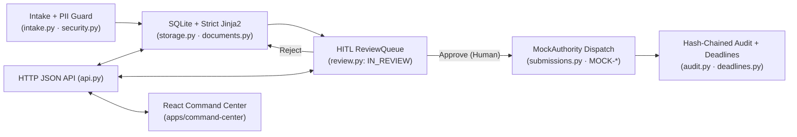

# LEGALTECH INNOVATION LAB — MISSION 001 REPORT

**Date:** 2026-11-15  
**Orchestration Model:** Gemini 4 Argon (Planning, Architecture & Review) + Gemini 4 Hydrogen (Implementation, Worktrees & Verification)  
**Target Repository:** `/Users/user/.gemini/antigravity/scratch/legaltech-innovation-lab`  
**Active Branch:** `dev/mission-001` (`main` untouched at root commit `119c13d` pending human merge approval)

---

## 1. Phase 0 — Discovery & Repository Lineage

| Asset | Location / Remote | Branch & State | Architectural Role & Security Posture |
| :--- | :--- | :--- | :--- |
| **`legal-practice-agent`** (Existing Prototype) | `https://github.com/ponchogf88/legal-practice-agent` Cloned untouched at `/Users/user/.gemini/antigravity/scratch/legal-practice-agent` | `main` (`fdea172`, `0b35da5`) | Minimal Python `>=3.11` CLI demo (`jinja2`, `pytest`), in-memory `ReviewQueue`, `SubmissionBlockedError` gate, `MockAuthority`, append-only JSONL audit log. All 6 original tests pass untouched. |
| **`legaltech-innovation-lab`** (Master Lab Monorepo) | Local Git repo at `/Users/user/.gemini/antigravity/scratch/legaltech-innovation-lab` (no public remote created or pushed) | `dev/mission-001` (`main` at `119c13d`) | Master monorepo integrating `packages/legal_engine` (SQLite persistence, SHA-256 hash-chained audit trail, PII/governance guardrails, stdlib HTTP JSON API) and `apps/command-center` (React 18 + Vite UI). |
| **Unversioned Local UI Prototype** (Quarantined) | `/Users/user/legal-case-command-center` (unversioned, outside workspace) | Unversioned local directory | **SEC-01 Quarantine:** Contains unredacted civil litigation details and local filesystem references. Strictly quarantined: never copied or committed to `legaltech-innovation-lab`. |

---

## 2. Phase 1 & 3 — Architecture & Isolated Worktree Execution

Four parallel engineering workstreams executed via dedicated subagents in isolated Git worktrees (`legaltech-worktrees/`) with strictly disjoint file ownership, followed by `--no-ff` merges into `dev/mission-001` and cleanup of temporary worktrees:

| Workstream | Branch | Worktree Commit | Merge Commit (`dev/mission-001`) | Deliverables |
| :--- | :--- | :--- | :--- | :--- |
| **A — Docs & Governance** | `feat/docs-governance` | `a1afe48` | `ddda412` | `README.md`, `AGENTS.md`, `TASKS.md`, `SECURITY.md`, `docs/ARCHITECTURE.md`, `docs/DESIGN_SYSTEM.md` |
| **B — Backend & SQLite** | `feat/backend-core` | `3b88834` | `8c46f7d` | 13 modules in `packages/legal_engine/`, 2 Jinja2 templates in `templates/`, 2 synthetic JSON payloads in `examples/` |
| **C — Security & Privacy** | `feat/security-privacy` | `3ec6edd` | `920aa5b` | `packages/legal_engine/security.py`, `tests/test_security_guardrails.py` |
| **D — Frontend UI** | `feat/frontend-ui` | `281e359` | `d8f4e87` | 12 files in `apps/command-center/` (Design tokens, 3-column workstation, synthetic case `EXP-SINT-2026-001`, interactive HITL gate) |
| **E — Integration & QA** | `dev/mission-001` | `8ff5bb0` | HEAD | `tests/conftest.py`, `tests/test_engine_core.py`, `tests/test_storage_sqlite.py`, `tests/test_api_endpoints.py`, CLI & synthetic RFC integration fixes |

### Pipeline Overview

---

## 3. Phase 4 — Verification & Security Audit Summary

### Automated Tests Executed
- **`legaltech-innovation-lab` (`.venv/bin/pytest -v`):** **50 passed** (0 failed, 0 skipped):
  - `tests/test_engine_core.py` (9 tests: HITL submission block, approval -> mock receipt, rejection -> DRAFT, intake validation & PII block, invalid transition error, Jinja2 StrictUndefined rendering, deadlines & unknown authority, SHA-256 tamper detection, CLI `demo` / `--stop-before-submit` / `security-check`).
  - `tests/test_storage_sqlite.py` (1 test: full file-backed SQLite reopen round-trip across matters, documents, submissions, and evidence items).
  - `tests/test_api_endpoints.py` (2 tests: API dispatcher lifecycle + 403 security block + 409 HITL block, and live `ThreadingHTTPServer` HTTP endpoint).
  - `tests/test_security_guardrails.py` (38 tests: Mexican RFC/CURP/CLABE detection, token/private-key detection, quarantined real-case marker blocking, synthetic SAT allowlist `XAXX010101000`/`XEXX010101000`, EU AI Act / LFPDPPP governance readiness evaluator, full repository tree scan returning `[]`).
- **`legal-practice-agent` (`.venv/bin/pytest -v`):** **6 passed** (0 failed, 0 skipped) — reference prototype verified unmodified.
- **CLI End-to-End & Security Check:**
  - `.venv/bin/python -m legal_engine.cli demo` -> Exit `0`, issued `MOCK-*` folio, `Audit chain integrity: VALID (4 entries)`.
  - `.venv/bin/python -m legal_engine.cli demo --stop-before-submit` -> Exit `0`, blocked dispatch in `IN_REVIEW` with `SubmissionBlockedError`.
  - `.venv/bin/python -m legal_engine.cli security-check` -> Exit `0`, `"scan_clean": true`, `"governance_ready": true`, score `6/6` under `EU AI Act + LFPDPPP + HITL Lab Policy`.
- **Frontend Production Build (`apps/command-center`):**
  - `npm run build` (`vite build`) -> Exit `0`, 1408 modules transformed, output generated cleanly in `dist/`.

### Security Findings & Mitigations Resolved
1. **SEC-01 (Quarantined Legacy Prototype):** Legacy folder `/Users/user/legal-case-command-center` contains real civil case data and local filesystem paths. Quarantined completely; automated regex & marker scanner (`security.py`) prevents accidental ingestion or commit.
2. **SEC-02 (Synthetic RFC Compliance Caught by Guardrail):** Initial synthetic fixture used custom RFC-shaped placeholder strings caught by `test_scan_repository_tree_is_clean_on_repo_root`. Remediated immediately to SAT official generic synthetic placeholders (`XAXX010101000` / `XEXX010101000`).
3. **SEC-03 (CLI Governance Readiness Signature Integration):** Discovered and resolved parameter contract mismatch between `cli.py` and `security.evaluate_governance_readiness(agent_config)` plus added `__main__` guard to `cli.py`.
4. **SEC-04 (Symlink Ignore Hardening):** Updated `.gitignore` to ignore both `node_modules` and `node_modules/` so local dependency links are never staged.

---

## 4. Phase 5 — Outstanding Issues & Next Recommended Mission

### Outstanding Items
- **Pending Human Review Gate (`main` branch):** `dev/mission-001` has not been merged into `main`, and no GitHub remote has been created or pushed for `legaltech-innovation-lab`, preserving execution boundaries.
- **Offline Frontend Font Fallback:** `apps/command-center/index.html` references Google Fonts (`Instrument Serif`, `Plus Jakarta Sans`, `DM Mono`) with local system font fallbacks configured in `tokens.css`.

### Next Recommended Mission (`MISSION 002`)
1. Review and approve merging `dev/mission-001` into `main` (and optionally create private GitHub repository `ponchogf88/legaltech-innovation-lab`).
2. Execute **M2-01 (Playwright E2E Verification)**: launch `legal_engine.cli serve-api` alongside Vite dev/preview server and automate browser verification of the interactive HITL approval/rejection gate and Fact-vs-Conclusion inspector.
3. Execute **M2-04 (GitHub Actions CI Gate)**: wire automated `pytest -v`, `security-check`, and `vite build` checks on every pull request.
