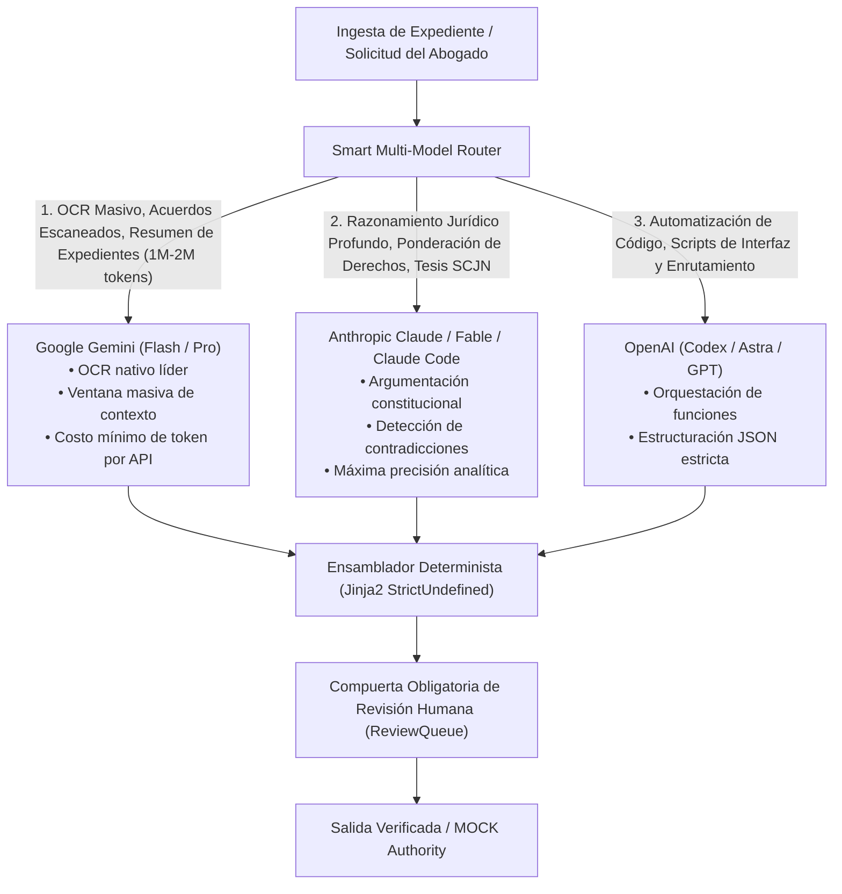

# 🧠 ESTRATEGIA MULTI-MODELO INTELIGENTE Y ANÁLISIS DE COMPETENCIA
## LegalTech Innovation Lab · Ecosistema de Litigio para Nuevo León y México

> **Origen y Contexto:** Documento maestro recuperado de las sesiones estratégicas de diseño y conceptualización de Chuy. Preserva íntegramente la visión de arquitectura multi-IA, el modelo de enrutamiento inteligente ("el modelo ideal para la tarea ideal"), el análisis comparativo de mercado y los mockups de diseño editorial.

---

## 1. Visión Estratégica del Producto

### 🎯 La Oportunidad en Nuevo León y México
Nuevo León cuenta con una infraestructura judicial pionera en México: el **Tribunal Virtual del Poder Judicial del Estado de Nuevo León**, sumado a los servicios en línea del **Poder Judicial de la Federación** (amparos) y el **Tribunal Federal de Justicia Administrativa (TFJA)**. Sin embargo, los litigantes enfrentan dispersión de herramientas, interfaces fragmentadas y una falta de orientación previa en la estructuración de demandas y denuncias ante fiscalías virtuales.

**El objetivo de la plataforma:**
No ser un simple "chatbot jurídico", sino un **Ecosistema Operativo Integral** con un agente jurídico personal y proactivo que:
1. Centralice en una sola ventana el monitoreo de expedientes de Nuevo León y Federales.
2. Estructure y narre hechos con rigor metodológico, evitando vicios de origen en promociones y denuncias.
3. Asista al abogado en la redacción determinista de escritos procesales sin margen de alucinación.
4. Opere bajo una compuerta estricta de revisión humana obligatoria (**Human-in-the-Loop - HITL**).

---

## 2. Análisis de Competencia Internacional y Nacional

| Plataforma | Origen / Enfoque | Fortalezas | Brecha / Oportunidad para Nuestro Lab |
| :--- | :--- | :--- | :--- |
| **Harvey AI** | Global (EE. UU.) · Alianza académica con UDEM en Monterrey (Nov 2026) | Respaldado por OpenAI; fuerte presencia en grandes firmas internacionales. | Enfoque corporativo genérico; costos prohibitivos para despachos medianos y litigantes; no está diseñado para las peculiaridades del Tribunal Virtual de NL. |
| **Robin AI / Casetext CoCounsel** | Global (UK / EE. UU.) | Revisión contractual y búsqueda jurisprudencial anglosajona. | Escasa adaptación al derecho procesal mexicano y a la jurisprudencia de la SCJN. |
| **HEX / IUX / Master Legal** | México | Gestión de despachos, cálculo de términos y seguimiento de expedientes. | Enfoque de software administrativo tradicional ("Excel con esteroides"). Carecen de agentes proactivos con razonamiento jurídico y auditoría criptográfica. |
| **Nuestra Ventaja Competitiva** | **Local / Nuevo León + Federal** | **Especialización procesal local**, arquitectura multi-modelo de costo ultra-eficiente, gobernanza estricta (LFPDPPP y EU AI Act) y estética editorial de centro de mando. |

---

## 3. Arquitectura del Smart Multi-Model Router
### *"El modelo ideal para la tarea ideal, sin encarecer al cliente"*

El error común en el mercado es "casarse" con un solo proveedor (todo OpenAI o todo Anthropic) o cobrarle al cliente el triple por usar varios modelos. Nuestra arquitectura implementa un **Enrutador Inteligente (Smart Model Router)** que distribuye las cargas de trabajo por especialidad técnica y costo por token:

### Matriz de Especialidad por Modelo:
1. **Google Gemini (Gemini 2.5/3 Pro & Flash):**
   - **Misión:** *Visión, OCR y Memoria Masiva.*
   - **Por qué:** Es el mejor procesador de documentos escaneados, fojas notariales y acuerdos borrosos. Su gigantesca ventana de contexto (hasta 2M de tokens) permite subir expedientes enteros de cientos de hojas a una fracción del costo de otros modelos.
2. **Anthropic Claude (Claude 3.5 Sonnet / Fable Five / Claude Code):**
   - **Misión:** *Razonamiento Jurídico Complejo y Hermenéutica.*
   - **Por qué:** Su capacidad de razonamiento lógico, ponderación de derechos humanos, análisis de usura mercantil y jurisprudencia supera a los modelos generalistas, reduciendo al mínimo el riesgo de sesgo o superficialidad.
3. **OpenAI (Codex / Astra for Law / GPT-4o):**
   - **Misión:** *Orquestación, Síntesis Estructurada e Integraciones.*
   - **Por qué:** Alta confiabilidad en generación de esquemas JSON, llamadas a herramientas (`tool-calling`) y automatización de pipelines operativos.

---

## 4. Concepto de Diseño: Editorial Command Center ("Mythos")

En las sesiones de conceptualización se descartaron las interfaces genéricas y se fijó la dirección visual **LegalTech Mythos**:
* **Atmósfera:** Editorial oscura de alta gama (fondos grafito/obsidiana con acentos cálidos ámbar/oro quemado).
* **Constelación de Agentes:**
  - **Nomos:** Guardián de Privacidad, PII y Gobernanza Regulatoria.
  - **Themis:** Análisis de fondo, separación estricta entre Hechos y Conclusiones.
  - **Dike:** Cotejo y trazabilidad probatoria de anexos documentales.
  - **Apollō:** Ensamblaje determinista de escritos legales sin texto sintetizado al azar.
  - **Chronos:** Motor de plazos procesales, términos judiciales y cuenta regresiva.
  - **Hermes:** Normalización e ingesta de expedientes y notificaciones.
* **Layout de 3 Columnas:**
  - *Columna Izquierda:* Carril de agentes y constelación de estado.
  - *Columna Central:* Vista dividida del expediente sintético y borrador con bindings en tiempo real.
  - *Columna Derecha:* Inspector forense de evidencias, compuerta HITL y línea de tiempo con hash-chain.

---

## 5. Próximos Pasos de Integración
1. Implementar la interfaz del `ModelRouter` en `packages/legal_engine/router.py`.
2. Conectar las métricas de tokens y costos en el tablero del Command Center para que el abogado visualice el ahorro en tiempo real.
3. Mantener este documento como directriz viva para futuras rondas de desarrollo y levantamiento de capital.
