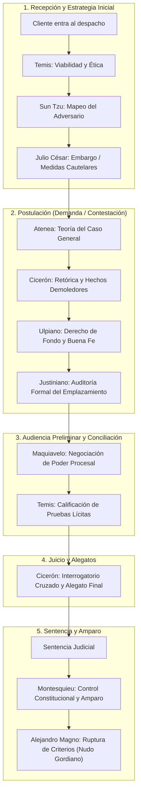

# Línea de Tiempo Procesal: Asignación de Agentes Históricos
**LegalTech Innovation Lab · Forensic Workflow Engine**

| Fase Procesal | Agente Principal | Misión Específica |
| :--- | :--- | :--- |
| **1. Entrada del Cliente** | **Temis & Sun Tzu** | Viabilidad del caso, solvencia de la contraparte y análisis costo-beneficio antes de demandar. |
| **2. Medidas Cautelares** | **Julio César** | Embargo precautorio y aseguramiento de cuentas para evitar insolvencia sobrevenida. |
| **3. Demanda / Contestación** | **Cicerón & Ulpiano** | Cicerón narra los hechos con fuerza retórica; Ulpiano fundamenta la justicia material y combate la usura. |
| **4. Notificación y Emplazamiento** | **Justiniano** | Blindaje adjetivo para que la notificación no pueda ser tumbada por incidente de nulidad. |
| **5. Conciliación y Audiencia Preliminar** | **Maquiavelo** | Negociación desde posición de fuerza procesal para cerrar convenios favorables. |
| **6. Pruebas y Desahogo** | **Temis & Cicerón** | Temis audita licitud de cadena de custodia; Cicerón redacta posiciones demoledoras para peritos y testigos. |
| **7. Alegatos de Clausura** | **Cicerón** | Síntesis argumentativa que amarra las pruebas desahogadas con la condena solicitada. |
| **8. Apelación y Juicio de Amparo** | **Montesquieu & Alejandro Magno** | Montesquieu ataca violaciones a derechos humanos y debido proceso; Alejandro rompe precedentes obsoletos. |
