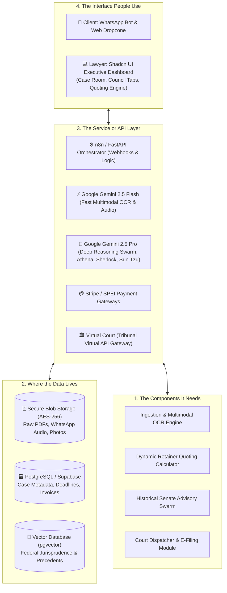

# Technical Architecture Walkthrough — LegalTech Innovation Lab

> [!IMPORTANT]
> **Executive Summary for Technical Review**: Complete architectural breakdown of the internal AI-powered legal platform designed to automate case intake, forensic document audit, multi-agent strategic reasoning, and court filings.

---

## 🏛️ Comprehensive Architecture Diagram

---

## 1. The Components It Needs (Componentes Necesarios)

1. **Multimodal Ingestion & OCR Component**:
   - Parses noisy, skewed judicial notifications, photocopies, stamps, and handwritten annotations.
   - Transcribes audio voice notes from clients and lawyer dictations into structured legal fact timelines.
2. **Dynamic Retainer Quoting Engine**:
   - Real-time algorithm calculating Phase 1 study fees based on page count, audio minutes, urgency multiplier (<48 hrs), and principal claim value.
3. **Multi-Agent Strategic Council (The Senate)**:
   - Specialized agent personas: **Sherlock** (evidence auditing), **Sun Tzu** (procedural timing/strategy), **Athena** (offensive exceptions/injunctions), **Alexander** (power settlements), and **Muse** (master coordinator/drafter).
4. **Court E-Filing & Dispatcher (Mercury)**:
   - Manages digital signatures (FIEL/e.firma), formats filings to jurisdictional standards, and handles submissions to the Virtual Court system.

---

## 2. Where the Data Lives (Dónde Residen los Datos)

1. **Document & Media Storage (Encrypted Blob Storage)**:
   - **Technology**: Google Cloud Storage / AWS S3 / MinIO.
   - **Security**: AES-256 at rest, TLS 1.3 in transit. Stores original court subpoenas, evidence photos, scanned contracts, and voice memos.
2. **Transactional & Case Metadata Database**:
   - **Technology**: PostgreSQL (managed via Supabase).
   - **Schema**: Tables for `clients`, `cases`, `deadlines`, `filings`, `quotations`, and `audit_logs`.
3. **Legal Knowledge & Jurisprudence Vector Store**:
   - **Technology**: `pgvector` inside PostgreSQL.
   - **Purpose**: Embeds Supreme Court jurisprudence, federal case law, and statutory codes to ground all agent arguments and avoid hallucinations.

---

## 3. The Service or API Layer (Capa de Servicios y APIs)

1. **Workflow & Event Orchestrator**:
   - Built on **n8n** and **Python FastAPI** microservices exposing secure webhooks for WhatsApp events and web submissions.
2. **Foundation AI Models (Dual-Tier Architecture)**:
   - **Fast Vision & Audio Tier**: `gemini-2.5-flash` for zero-latency (<2s) transcription, stamp detection, and initial triage.
   - **Deep Legal Reasoning Tier**: `gemini-2.5-pro` with *Thinking Mode* for multi-agent council deliberation and drafting of complex legal defenses.
3. **External Integrations**:
   - **Meta WhatsApp Cloud API**: Bidirectional messaging with clients.
   - **Payment APIs**: Stripe & SPEI webhooks for automatic quotation settlement.
   - **Court SOAP/REST Gateways**: Direct or robotic process submission to court dockets.

---

## 4. The Interface People Use (La Interfaz que Usa la Gente)

1. **For Clients (Zero Learning Curve)**:
   - **Primary**: Native WhatsApp chat with Muse (sending audios, photos, or documents like talking to their lawyer).
   - **Secondary**: Clean, single-purpose web dropzone for uploading heavy zip files and paying retainer invoices.
2. **For the Legal Team & Managing Attorney**:
   - **Executive Dashboard** built with **Next.js / Vite + Tailwind CSS + Shadcn UI** (`app_legaltech.html`):
     - **Triage Inbox**: Omnichannel pipeline with countdown timers on fatal deadlines.
     - **Senate Room**: Tabbed interactive workspace showing simultaneous strategic angles from Sherlock, Sun Tzu, and Athena.
     - **Dynamic Quoting Tool**: Real-time slider-based calculator for instant client engagement.
     - **One-Click Dispatch**: Single-click authorization to trigger Mercury's e-filing.
