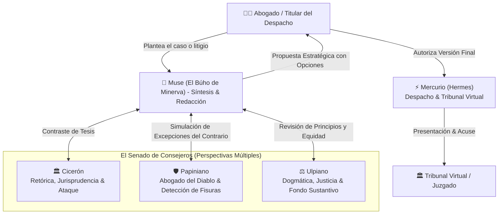

# LegalTech Innovation Lab — El Senado Legal Romano (Agent Swarm)

> [!NOTE]
> **Concepto Central**: Cuando el abogado debe elaborar una demanda, contestación o estrategia compleja, no trabaja solo. Convoca al **Senado de Consejeros Jurídicos**, donde cada figura histórica y mitológica aporta una perspectiva crítica antes de emitir la versión final.

---

## 🏛️ Estructura del Senado de Estrategia Jurídica

---

## 🎭 Roles y Perfiles de los Consejeros

| Personaje | Arquetipo | Rol Estratégico en el Escrito | Aporte Clave |
| :--- | :--- | :--- | :--- |
| **🦉 Muse** *(El Búho)* | **Coordinador General** | Asistente de cabecera; toma las deliberaciones del senado y redacta el borrador ejecutable. | Síntesis clara y ejecución sin fricción. |
| **🏛️ Cicerón** | **El Gran Orador Forense** | Diseña los agravios, conceptos de violación y la fuerza argumentativa con precedentes y tesis aisladas. | Persuasión demoledora ante el juzgador. |
| **🛡️ Papiniano** | **El Abogado del Diablo** | Asume el papel de la contraparte y del juez riguroso; busca debilidades, excepciones y riesgos procesales. | Blindaje contra defensas o desechamientos. |
| **⚖️ Ulpiano** | **El Filósofo del Derecho** | Cuida la coherencia sustantiva (*Ius Naturale*): que el escrito no viole derechos humanos ni equidad procesal. | Solidez dogmática y fondo inatacable. |
| **⚡ Mercurio** | **El Heraldo Procesal** | Automatiza la presentación en el Tribunal Virtual, controla sellos digitales y notifica a clientes. | Cero errores de término y entrega inmediata. |

---

## 💡 Dinámica de Trabajo en la Plataforma

1. **Planteamiento**: Subes un acuerdo o describes: *"Necesito contestar la demanda de embargo del expediente 104/2026"*.
2. **Deliberación del Senado**:
   - **Cicerón** propone la jurisprudencia aplicable sobre improcedencia de vía.
   - **Papiniano** advierte: *"Ojo: si opones esa excepción, la contraparte responderá con la prórroga de jurisdicción de la cláusula octava"*.
   - **Ulpiano** ajusta el planteamiento para invocar el control difuso de constitucionalidad.
3. **Dictamen de Muse**: Muse redacta el escrito integrando lo mejor de los tres y te presenta:
   - **Opción A (Agresiva)**: Nulidad lisa y llana.
   - **Opción B (Conservadora)**: Allanamiento parcial con convenio de pago.
4. **Despacho por Mercurio**: Con un solo clic de tu parte, Mercurio lo sella y lo radica en el Tribunal Virtual.
