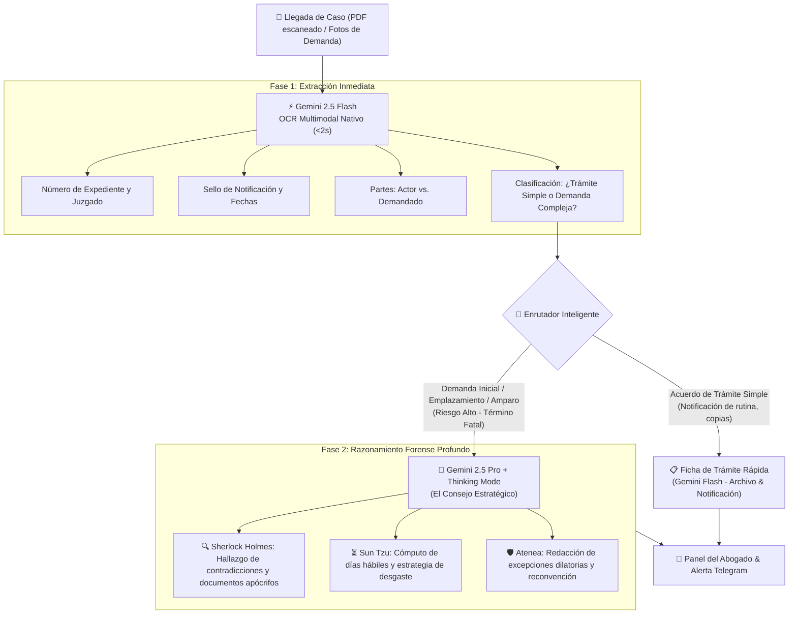

# Ingesta Inteligente de Demandas y Acuerdos Judiciales (Arquitectura Híbrida)

> [!TIP]
> **Optimización de Costos y Latencia**: No todos los documentos requieren un modelo de razonamiento pesado. Usar un **modelo rápido y económico para OCR visual** y reservar el **modelo de razonamiento profundo solo para el análisis estratégico de litigios complejos** hace que tu plataforma sea instantánea y de costo casi nulo ($0).

---

## 🏛️ Diagrama del Flujo de Ingesta y Enrutamiento

---

## 🔍 Desglose de los Dos Tiers

### 1. Tier Rápido: OCR Multimodal (Gemini 2.5 Flash)
- **El problema del OCR tradicional**: Los motores OCR antiguos (Tesseract, Adobe) fallan miserablemente con sellos borrosos de juzgados, hojas chuecas o anotaciones manuales al margen.
- **La solución de Gemini Flash**: Gemini 2.5 Flash tiene **visión multimodal nativa**. No hace OCR texto por texto; "mira" el documento como un humano, lee el sello de tinta morada del actuario, entiende la caligrafía y extrae en 1.5 segundos:
  - Fecha en que surte efectos la notificación.
  - Vía del juicio (Ejecutivo Mercantil, Oral Civil, Laboral, etc.).
  - Monto exacto de las prestaciones reclamadas.

### 2. Tier de Razonamiento Profundo: El Senado Legal (Gemini 2.5 Pro)
Si el documento es una **demanda formal**, el sistema no se conforma con resumir: activa el razonamiento profundo:
- **Cómputo Fatal**: Identifica si tienes 8, 9, 15 o 30 días para contestar, descontando fines de semana e inhábiles del calendario judicial.
- **Filtro de Excepciones**: Evalúa de inmediato si procede promover:
  - Incompetencia de jurisdicción.
  - Falta de personalidad en el apoderado del actor.
  - Oscuridad de la demanda.
- **Borrador de Contestación**: Redacta el capítulo de hechos contestando punto por punto (*"Es falso y se niega..."*) con las pruebas que Sherlock detecte necesarias.

---

## 📂 Archivo de Configuración Listo

El flujo completo de n8n con los nodos y prompts calibrados quedó guardado en:  
[`04_ingesta_demandas_ocr_enrutador_ia.json`](file:///C:/Users/USUARIO/laboratorio-asistente-ia/workflows/04_ingesta_demandas_ocr_enrutador_ia.json)
