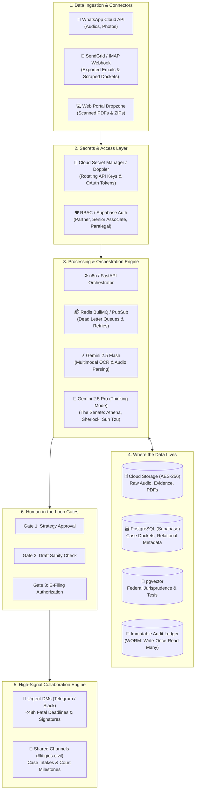
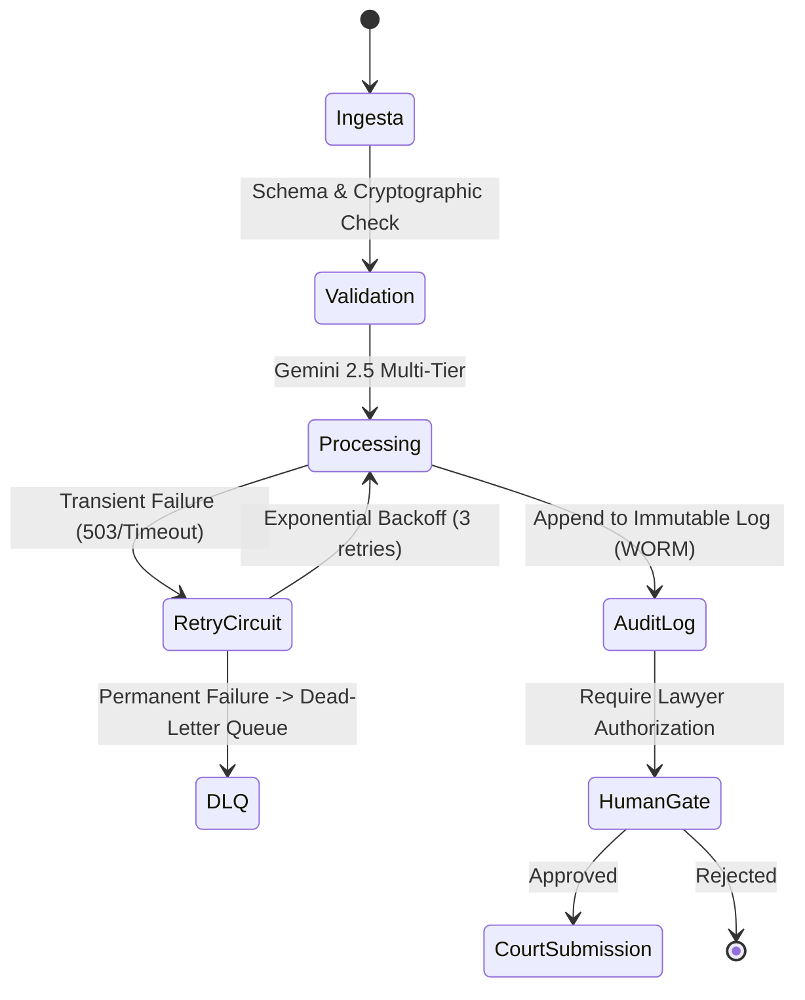

# Technical Architecture & Operations Blueprint — LegalTech Innovation Lab

> [!IMPORTANT]
> **Master Technical Evaluation Guide**: Comprehensive architectural specification covering core components, data residency, API security, unstructured data ingestion, team communication topologies, adoption analytics, and fault-tolerant reliability patterns.

---

## 🏛️ End-to-End System Architecture

---

## 1. Core Architecture (The 4 Pillars)

### A. The Components It Needs
1. **Multimodal Ingestion & Document Parser**: Processes noisy scans, angled photos of subpoenas, voice notes, and messy email exports.
2. **Dynamic Retainer Quoting Engine**: Instant pricing calculator for preliminary case analysis based on volume, complexity, and urgency.
3. **Multi-Agent Strategic Senate**: Modular personas (**Athena** for offensive actions, **Sherlock** for forensic proof auditing, **Sun Tzu** for procedural timing, **Alexander** for fast settlements, and **Muse** for master drafting).
4. **E-Filing & Court Dispatcher (Mercury)**: Connects to judicial APIs (Tribunal Virtual), verifies signatures, and tracks receipt tokens.

### B. Where the Data Lives
- **Files & Binary Media**: Encrypted Object Storage (Google Cloud Storage / AWS S3) with **AES-256 at rest** and TLS 1.3 in transit.
- **Relational & Structured Metadata**: **PostgreSQL** (hosted via Supabase), tracking dockets, court stages, parties, quotes, and timestamps.
- **Semantic & Legal Memory (RAG)**: **pgvector** storing Supreme Court (*SCJN*) jurisprudence, statutory codes, and firm precedent briefs.
- **Tamper-Evident Audit Logs**: Dedicated append-only table or Cloud Audit Logging ensuring chain of custody.

### C. The Service or API Layer
- **Orchestration**: Microservices containerized in Docker, orchestrated via **n8n** and **Python FastAPI**.
- **AI Dual-Tier**:
  - `gemini-2.5-flash`: Real-time OCR and voice transcription (<2s, sub-cent cost).
  - `gemini-2.5-pro`: Deep legal reasoning and argument formulation.
- **External Connectors**: Meta WhatsApp Cloud API, Stripe/SPEI webhooks, Virtual Court REST/SOAP endpoints.

### D. The Interface People Use
- **For Clients**: Native **WhatsApp interface** (zero learning curve) plus a sleek, branded Web Dropzone to upload large archives.
- **For Lawyers & Team**: A high-productivity **Shadcn UI Dashboard** (`app_legaltech.html`) with real-time deadline countdowns, Senate tabs, and one-click dispatch buttons.

---

## 2. Third-Party APIs, Secrets Management & Ingesting Messy Data

### What It Has to Connect To
1. **Meta WhatsApp Cloud API**: Inbound audio notes, photos, and client interaction.
2. **SendGrid / Postmark / IMAP**: Ingestion of forwarded court notification emails and electronic dockets (*Boletín Judicial*).
3. **Payment Gateways (Stripe / Mercado Pago / SPEI STP)**: Instant retainers and fee collection.
4. **Judicial Portals (Tribunal Virtual / PJENL / SISE CJF)**: Automated filing submission and status scraping.

### How Credentials and Secrets Are Handled
- **Zero Secrets in Code**: No API keys or credentials stored in git repositories or `.env` files checked into source control.
- **Cloud Secret Manager (GCP Secret Manager / AWS Secrets Manager)**: Production secrets injected dynamically at runtime via environment variables with auto-rotation.
- **Least-Privilege Service Accounts**: Services use IAM roles (e.g., Workload Identity Federation) rather than static root keys.
- **Digital Certificates (FIEL / e.firma)**: Private keys encrypted with client-side HSM passphrases; the system never stores unencrypted private keys.

### Ingesting Messy & Unstructured Data (Scraping, Exports, Forwarded Emails)
- **Scraping Court Dockets**: Headless browser workers (Playwright) running in ephemeral containers with proxy rotation, extracting daily PDF gazettes.
- **Forwarded Email Normalization**: A webhook receives raw MIME/EML emails, strips HTML boilerplate, extracts PDF/DOCX attachments, and routes metadata to Gemini Flash.
- **Multimodal Visual Fallback**: When an export is a corrupted scan or photo taken on a desk, Gemini Flash uses visual layout recognition to extract fields without relying on brittle regex or traditional OCR parsers.

---

## 3. Collaboration, Team Velocity & High-Signal Notifications

### How It Makes the Team Faster
- Eliminates 4 to 6 hours of manual transcription, docket checking, and initial draft formatting per case.
- Reduces trial deadline calculation errors to **zero**.

### Notification Topology: Direct Messages (DMs) vs. Shared Channels
| Priority / Urgency | Target Audience | Channel | Trigger Event |
| :--- | :--- | :--- | :--- |
| **🚨 P0 (Fatal / Urgent)** | Lead Attorney | **Direct Message (Telegram / WhatsApp / SMS)** | • Court deadline expiring in < 48 hours. • Unread judicial subpoena received. • Client paid retainer fee. |
| **⚠️ P1 (Action Needed)** | Assigned Associate | **Direct Message + Dashboard Task** | • Draft ready for human review (Gate 2). • Sherlock found proof contradiction. |
| **📢 P2 (Team Awareness)** | Entire Litigation Team | **Shared Channel (#litigios-mercantil)** | • Case intake created. • Successful court filing confirmation (Mercury acuse). |
| **ℹ️ P3 (Informational)** | Silent Logging | **Dashboard Activity Feed Only** | • Raw file uploaded. • Background OCR completed. |

### Keeping the Signal High (Noise Suppression)
- **Intelligent Deduplication**: Merges repeated court notices about the same docket into a single notification thread.
- **Digest Bundling**: Non-urgent updates (P2/P3) are batched into a daily morning brief (8:00 AM) rather than pinging every 10 minutes.
- **Quiet Hours Enforcement**: No notifications between 9:00 PM and 7:00 AM unless classified as P0 (fatal constitutional or habeas corpus deadlines).

---

## 4. Adoption Analytics & Trustworthiness

### How to Know People Actually Use It (Telemetry & Adoption Metrics)
1. **Time-to-Dispatch (TTD)**: Measures hours elapsed between case intake and court filing (baseline: 48 hours vs. firm historic 7 days).
2. **Weekly Active Lawyers (WAL)**: Frequency of associates engaging with the Senate and approving drafts.
3. **Draft Acceptance Rate (DAR)**: Percentage of AI-generated paragraphs accepted without manual rewrite (target: > 75%).
4. **Retainer Conversion Rate**: Percentage of client quotes paid via the instant payment link within 24 hours.

### Making It Trustworthy (Enterprise Grade)

1. **Audit Logs (Tamper-Evident Ledger)**:
   - Every agent decision, prompt execution, document access, and user approval is recorded with user ID, IP, SHA-256 file checksum, and millisecond timestamp.
   - Stored in a Write-Once-Read-Many (WORM) audit table for legal accountability in malpractice defense.
2. **Retries & Failure Handling**:
   - **Exponential Backoff with Jitter**: Automatic retry policy for external court APIs and AI endpoints (1s, 2s, 4s, 8s).
   - **Dead-Letter Queue (DLQ)**: Failed tasks after 3 retries are isolated into a DLQ; on-call engineer and attorney alerted immediately.
   - **Idempotency Keys**: Court filings utilize UUID idempotency tokens to ensure a motion is **never submitted twice**.
3. **Secrets and Permissions (RBAC)**:
   - **Role-Based Access Control**:
     - *Managing Partner*: Full administrative access, financial analytics, fee formula override.
     - *Senior Associate*: Case management, Strategy approval, E-filing authorization.
     - *Junior / Intern*: Ingestion upload, review assistance (read-only on sensitive quotes).
     - *Client*: Restricted portal view showing only their specific case progress and invoice.
4. **Where the Human Stays in the Loop (HITL)**:
   - **No Autonomous Court Filing**: The system is an accelerator, not an autonomous attorney. **Mercurio will never hit the court API without human e-signature**.
   - **Explicit Confirmation Checkpoints**:
     - *Checkpoint 1*: Lawyer reviews the Senate's strategic direction.
     - *Checkpoint 2*: Lawyer reviews and edits the final legal pleading.
     - *Checkpoint 3*: Final authorization of statutory court submission.
