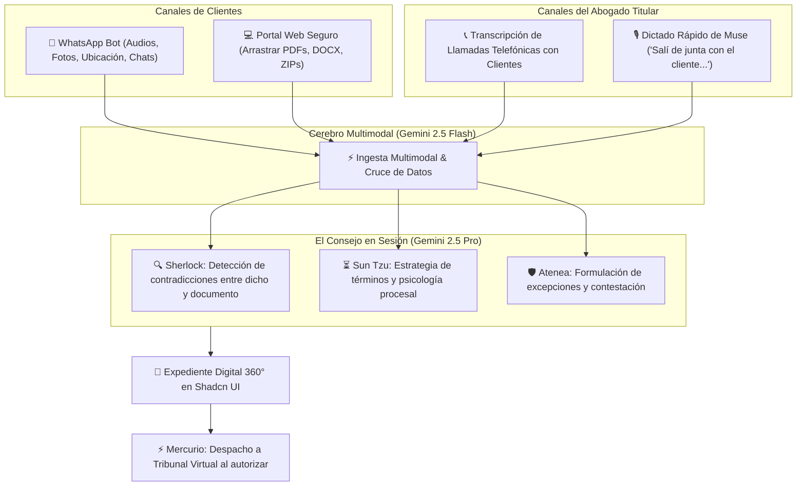

# Buzón Multimodal Omnicanal — Ingesta Total (Web + WhatsApp + Llamadas)

> [!IMPORTANT]
> **Canales Sin Restricciones**: El cliente entra por donde le sea más cómodo (WhatsApp o Portal Web Drag & Drop). El abogado puede alimentar el sistema mediante **dictados de voz posteriores a llamadas telefónicas o juntas presenciales**.

---

## 🏛️ Ecosistema Integral de Ingesta

---

## 🎙️ El Módulo "Dictado Rápido del Abogado"
A menudo el cliente le cuenta los detalles más delicados al abogado por teléfono o en un café:
- El abogado no tiene tiempo de sentarse a transcribir.
- Abre la app o le manda un audio a Muse de 60 segundos:
  > *"Muse, expediente 405/2026. Acabo de hablar con el cliente. Me confiesa que firmó el pagaré en blanco en 2024, pero que le entregó 100,000 pesos en efectivo al cuñado del actor sin recibo. Hay dos testigos presenciales que son sus empleados."*
- **Acción inmediata del sistema**:
  - Muse transcribe y extrae los hechos procesales.
  - Sherlock advierte: *"El pago a terceros no extingue la obligación cambiaria sin poder especial; preparemos la testimonial de los dos empleados para acreditar el mandato tácito"*.
  - El borrador de la contestación se actualiza automáticamente en el expediente.

---

## 💻 Estado del Proyecto y Próximo Paso
1. **Canales**: Web + WhatsApp + Dictado de Voz.
2. **Motor**: Gemini 2.5 Flash (Visión + Audio) y Gemini 2.5 Pro (Razonamiento del Consejo).
3. **UI**: Componentes limpios y ejecutivos de **Shadcn UI**.
4. **Despacho**: Automatización con **n8n** y **Mercurio**.
