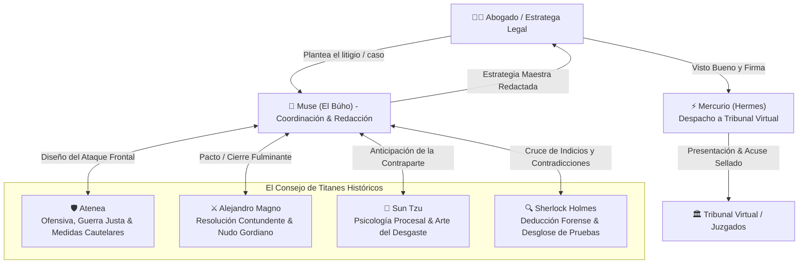

# LegalTech Innovation Lab — El Consejo Histórico y Mitológico (Multi-Agent Advisory Board)

> [!IMPORTANT]
> **Concepto Magistral**: En litigios de alto impacto o redacción de escritos complejos, la plataforma te permite convocar al **Consejo Estratégico Histórico**. Cada figura encarna una especialidad táctica para que ningún ángulo del caso quede descubierto.

---

## 🏛️ Mapa del Consejo Estratégico Multi-Agente

---

## 👑 Especialidades de los Consejeros

| Consejero | Arquetipo Universal | Rol en tu Litigio / Negocio | Aporte Táctico Concreto |
| :--- | :--- | :--- | :--- |
| **🛡️ Atenea** | **Diosa de la Guerra Justa** | **Ofensiva Procesal**: Diseña la demanda inicial, medidas cautelares agresivas (embargos, providencias precautorias) y suspensiones en amparo. | *"Golpear primero con legitimidad y contundencia procesal para fijar las reglas del juicio."* |
| **⚔️ Alejandro Magno** | **El Conquistador Audaz** | **El Nudo Gordiano**: Rompe estancamientos en negociaciones. Diseña acuerdos transaccionales de poder y salidas rápidas sin litigios eternos. | *"Identificar el punto neurálgico del adversario para forzarlo a capitular o pactar de inmediato."* |
| **📜 Sun Tzu** | **El Estratega del Arte de la Guerra** | **Maniobras y Desgaste**: Mapea las intenciones del juez y la contraparte. Usa incidentes de previo pronunciamiento y tiempos procesales para cansar al rival. | *"El supremo arte de litigar es desarmar la pretensión del contrario antes de pisar la audiencia."* |
| **🔍 Sherlock Holmes** | **El Maestro de la Deducción** | **Auditoría Forense y de Pruebas**: Revisa contratos, estados de cuenta, firmas y declaraciones testimoniales en busca de contradicciones sutiles. | *"Encontrar la inconsistencia oculta en los documentos del adversario que desmorona su teoría del caso."* |
| **🦉 Muse** | **El Búho de la Sabiduría** | **Síntesis Ejecutiva**: Modera a los consejeros, equilibra sus opiniones y te entrega el escrito listo, pulido y fundamentado. | Redacción legal impecable con opciones A, B y C. |
| **⚡ Mercurio** | **El Heraldo Alado (Hermes)** | **Operación y Entrega**: Radicación automática en el Tribunal Virtual, timbrado digital y monitoreo 24/7 de acuerdos publicados. | Cero vencimientos de término fatal y entrega inmediata. |

---

## ⚡ Caso Práctico: ¿Cómo opera en tu pantalla?

1. **Tu instrucción**: *"Muse, el demandado nos acaba de contestar con facturas falsas y una excepción de incompetencia."*
2. **El Consejo entra en sesión**:
   - **Sherlock** escanea los metadatos de las facturas: *"Detecté que el sello digital no coincide con el folio fiscal del SAT; son apócrifas."*
   - **Sun Tzu** evalúa el terreno: *"Interpuso la incompetencia solo para ganar 6 meses. No caigamos en el juego de contestar largo; ataquemos la falta de personería."*
   - **Atenea** plantea la ofensiva: *"Denunciemos fraude procesal en el mismo escrito y solicitemos vista al Ministerio Público."*
   - **Alejandro Magno** propone el remate: *"Con la denuncia penal sobre la mesa, ofrezcamos un convenio extrajudicial con embargo en garantía en 48 horas."*
3. **Muse**: Redacta la promoción con la fundamentación procesal y las pruebas de Sherlock listas.
4. **Mercurio**: Lo presenta ante el Tribunal Virtual y te manda el acuse con código QR a tu teléfono.
