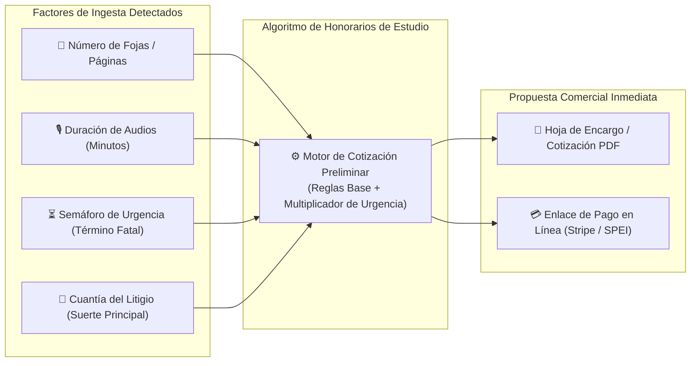

# Módulo de Cotización Dinámica de Honorarios Preliminares (Hoja de Encargo)

> [!TIP]
> **Modelo de Negocio Jurídico Moderno**: Ningún abogado debe regalar el estudio inicial del caso. Cuando el cliente envía su material, el sistema genera automáticamente una **Cotización de Estudio y Dictamen Estratégico** antes de redactar la demanda o contestación completa.

---

## 💰 Matriz de Cálculo de Honorarios Preliminares

---

## 📊 Fórmulas de Cotización por Parámetros

| Parámetro | Rango / Criterio | Tarifa Base Sugerida | Impacto en el Cálculo |
| :--- | :--- | :--- | :--- |
| **Volumen de Fojas** | 1 a 30 páginas 31 a 100 páginas 100+ fojas (Expediente voluminoso) | $1,500 MXN $3,500 MXN +$25 MXN por foja extra | Costo de análisis documental y compulsa de pruebas. |
| **Material Multimedia** | Hasta 15 min de audio 15 a 60 min de audio 60+ min (Llamadas completas) | Incluido en base +$500 MXN +$1,000 MXN | Procesamiento, transcripción y extracción fáctica. |
| **Factor de Urgencia** | Término > 8 días hábiles Término entre 3 y 7 días Término < 48 horas (Emergencia) | Factor 1.0 (Normal) Factor 1.3 (+30%) Factor 1.75 (+75%) | Compensación por trabajo urgente y nocturno del despacho. |
| **Cuantía del Asunto** | Menor a $100,000 MXN $100,000 a $1,000,000 MXN Mayor a $1,000,000 MXN | Tarifa Plana +0.5% del reclamo +1.0% del reclamo | Responsabilidad jurídica proporcional al riesgo del cliente. |

---

## 📑 Ejemplo de Propuesta Automática al Cliente

> **PROPUESTA DE ESTUDIO Y DICTAMEN ESTRATÉGICO**  
> **Cliente:** Inmobiliaria del Norte S.A. de C.V.  
> **Asunto:** Contestación de Juicio Ejecutivo Mercantil (Exp. 502/2026)  
> **Material Recibido:** 42 fojas escaneadas + 2 notas de voz (18 min).  
> **Vencimiento de Término:** 5 días hábiles (Urgencia Media).  
> 
> **Concepto:**  
> - Auditoría forense de pagaré y títulos de crédito adjuntos.  
> - Deliberación del Consejo Legal (Atenea, Sun Tzu y Sherlock Holmes).  
> - Emisión de Dictamen de Viabilidad y Borrador de Excepciones Procesales.  
> 
> **Inversión de Estudio Inicial:** **$4,850.00 MXN** *(IVA incluido)*  
> *(Este monto se acreditará al 100% como anticipo de honorarios si contrata la defensa integral del juicio).*  
> 
> [ 👉 Pagar Estudio del Caso con Tarjeta o SPEI ]

---

## 🛡️ Beneficios para el Abogado
1. **Cobro Inmediato**: Monetizas el tiempo de lectura, compulsa y análisis desde el minuto uno.
2. **Filtro de Clientes Serios**: El cliente que no paga un estudio inicial de bajo costo, difícilmente pagará los honorarios de un litigio largo.
3. **Formalidad Institucional**: Transmite seriedad corporativa, transparencia y rigor matemático en tus tarifas.
