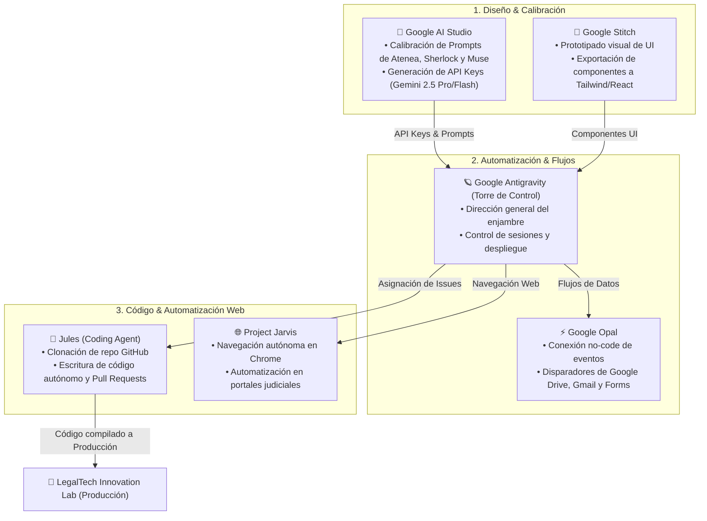

# Guía Maestra: Integración del Ecosistema de IA de Google en LegalTech Lab

> [!IMPORTANT]
> **Sinergia del Ecosistema Google**: Cada herramienta de Google cumple un rol estratégico dentro del ciclo de vida de tu aplicación. Antigravity actúa como la **torre de control** que orquesta a las demás.

---

## 🏛️ Mapa de Integración del Ecosistema Google

---

## 🛠️ ¿Cómo se conecta cada herramienta en tu proyecto?

### 1. 🔬 Google AI Studio (El Cerebro y Laboratorio)
- **Para qué se usa**: Es tu banco de pruebas para afinar la inteligencia del Consejo.
- **Acción concreta**:
  - Subes un PDF real de una demanda de 50 páginas.
  - Ajustas el *System Prompt* de **Sherlock Holmes** para afinar cómo detecta contradicciones.
  - Activas el *Thinking Mode* de **Gemini 2.5 Pro** y obtienes tu `GEMINI_API_KEY` gratuita con cuotas generosas.

### 2. 🎨 Google Stitch (Diseño de Interfaces)
- **Para qué se usa**: Prototipado visual rápido de pantallas.
- **Acción concreta**:
  - Le pides a Stitch: *"Diseña una tarjeta ejecutiva de semáforo de riesgo para juicios mercantiles con estética oscura y minimalista"*.
  - Stitch genera el layout visual que luego pasamos a los componentes de **Shadcn** en `app_legaltech.html`.

### 3. ⚡ Google Opal (Workflows No-Code Nativos)
- **Para qué se usa**: Orquestación visual dentro del entorno Google (alternativa/complemento a n8n).
- **Acción concreta**:
  - Escucha cuando un cliente sube una carpeta a un Google Drive compartido del despacho.
  - Pasa los archivos a Gemini Flash para OCR y actualiza una hoja de cálculo en Google Sheets como base de datos inicial sin escribir código de backend.

### 4. 🤖 Jules (El Agente Programador de GitHub)
- **Para qué se usa**: Desarrollador autónomo que trabaja directamente en tu repositorio de GitHub.
- **Acción concreta**:
  - Vinculamos a Jules con tu repositorio `laboratorio-asistente-ia`.
  - Le decimos a Jules: *"Implementa el cálculo de honorarios de fojas y minutos en el archivo calculator.js y genera los tests unitarios"*.
  - Jules clona el repositorio en la nube de Google, escribe el código, corre las pruebas y te abre un **Pull Request** listo para fusionar.

### 5. 🌐 Project Jarvis (Navegación Web Autónoma en Chrome)
- **Para qué se usa**: Automatización de portales externos que no tienen API abierta (como juzgados locales o tribunales virtuales).
- **Acción concreta**:
  - Jarvis toma el control del navegador a través del puerto CDP que ya configuramos hoy, navega al portal judicial, inicia sesión de forma segura y descarga los acuerdos del día.

### 6. 🪐 Google Antigravity (La Torre de Control)
- **Para qué se usa**: Es la mente maestra donde estamos tú y yo ahora mismo.
- **Acción concreta**:
  - Integra las piezas: toma los prompts de AI Studio, supervisa los Pull Requests de Jules, coordina a los agentes del Consejo y te entrega la plataforma lista y probada.
