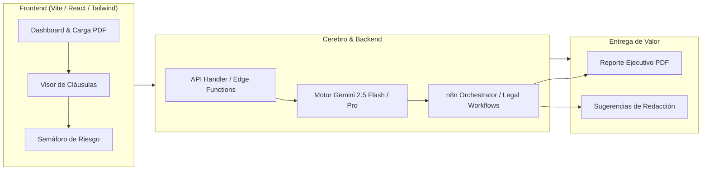

# LegalTech Innovation Lab — Plan de Ejecución Continua 48h (Agent Swarm)

> [!IMPORTANT]
> **Modelo de Ejecución**: Trabajo continuo autónomo con enjambres de agentes de IA (sin pausas ni tiempos muertos humanos).
> **Meta**: Lanzamiento de un MVP 100% funcional para análisis de contratos y dictaminación de riesgos legales.
> **Duración total estimada**: 36 a 48 horas continuas.

---

## 1. Arquitectura Técnica del MVP

---

## 2. Cronograma de Ejecución Continua (0 a 48 Horas)

| Bloque | Horas | Fase / Enfoque | Rol de Agentes | Entregables Clave |
| :--- | :--- | :--- | :--- | :--- |
| **01** | **00:00 – 06:00** | **Arquitectura y Core Legal** | Architect & Prompt Engineer | - Esquema JSON de salida de análisis legal. - Prompts maestros calibrados para Gemini 2.5 Pro. - Flujo base en n8n para ingesta de documentos. |
| **02** | **06:00 – 18:00** | **Construcción de Interfaz (UI/UX)** | Frontend Specialist | - Componente de carga drag-and-drop de contratos (PDF/DOCX). - Vista dividida: documento original vs. cláusulas detectadas. - Panel de semáforos de riesgo (Rojo, Amarillo, Verde). - Implementación de componentes estilo Shadcn / Aceternity. |
| **03** | **18:00 – 30:00** | **Integración y Extracción de Datos** | Full-Stack Integrator | - Pipeline de extracción de texto y tokenización. - Conexión segura entre UI y API de Gemini. - Mapeo de riesgos contractuales (responsabilidad, penas convencionales, jurisdicción). |
| **04** | **30:00 – 42:00** | **Auditoría, Seguridad y Pruebas** | QA & Security Agent | - Suite de pruebas con 10 contratos reales de muestra. - Verificación de latencia y respuesta bajo 5 segundos. - Blindaje de datos sensibles y cumplimiento de privacidad. |
| **05** | **42:00 – 48:00** | **Despliegue y Salida a Producción** | DevOps & Launch Lead | - Despliegue en producción (Vercel / Cloudflare Pages). - Conexión de dominio propio con certificado SSL. - Verificación en vivo y entrega del panel de control al usuario. |

---

## 3. Matriz de Componentes del Sistema

### A. Cerebro IA (Gemini 2.5 + Workflows)
- **Extracción de Entidades**: Partes involucradas, fechas clave, montos y vigencia.
- **Detección de Cláusulas Abusivas**: Desequilibrio de obligaciones, penalizaciones unilaterales, cesión indebida de derechos.
- **Generación de Redacción Alternativa**: Cláusulas equilibradas listas para copiar y pegar en negociaciones.

### B. Frontend (UI)
- Diseño responsivo, sobrio y enfocado en productividad legal.
- Visualización de contratos con resaltado dinámico de riesgos.
- Exportación en un clic de dictamen ejecutivo en PDF.

---

## 4. Próxima Decisión Inmediata

> [!TIP]
> **Elección de Estilo Visual**:
> - **Opción A (Shadcn UI)**: Extremadamente limpio, corporativo, rápido, estándar de la industria para software profesional.
> - **Opción B (Aceternity UI)**: Efectos visuales de vanguardia, microinteracciones modernas y estética futurista.
>
> Una vez confirmada tu preferencia, los agentes inician la generación de los componentes del **Bloque 02**.
